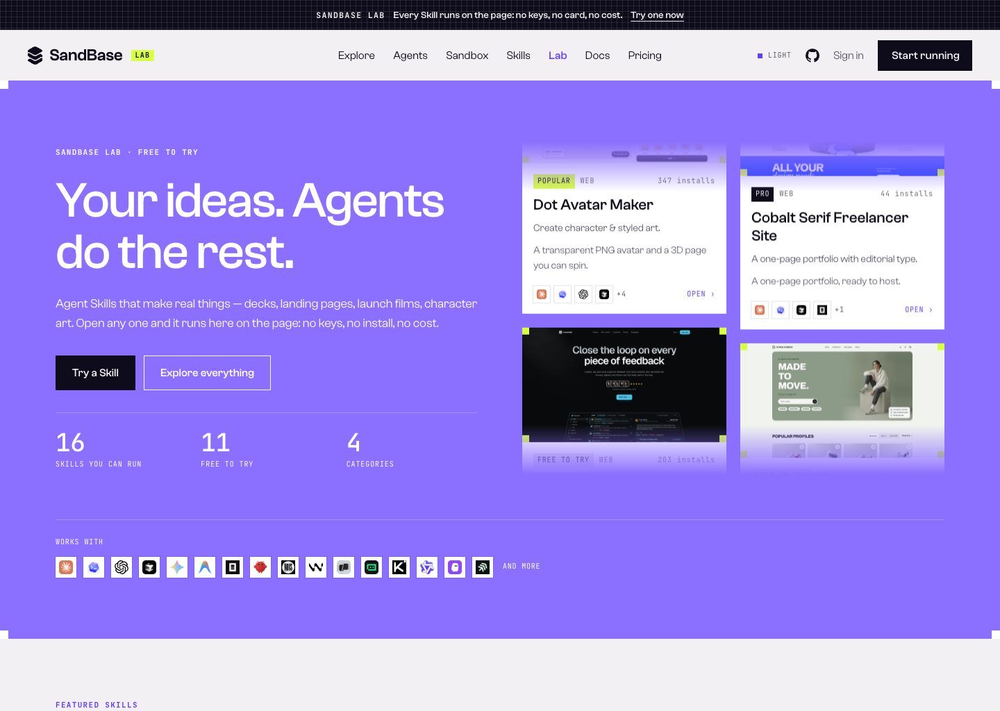
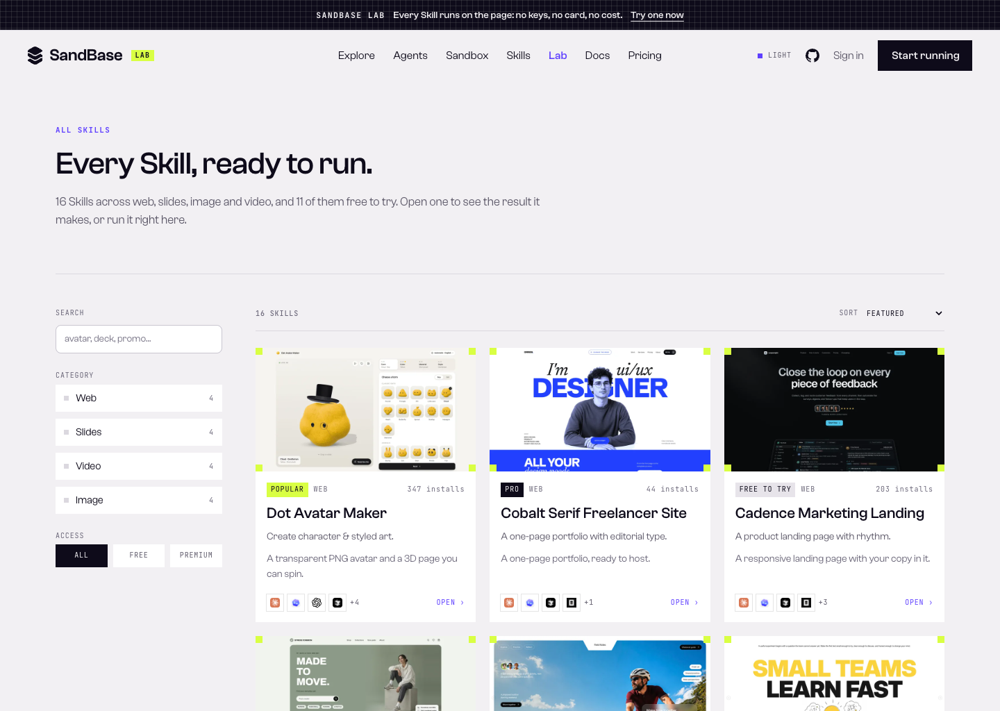
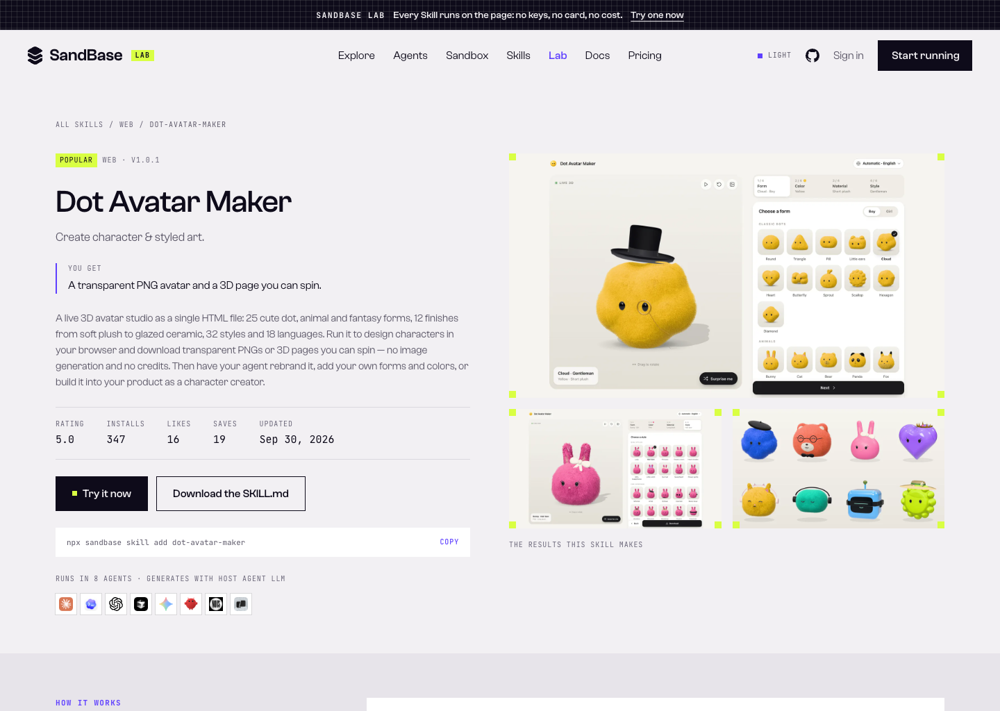
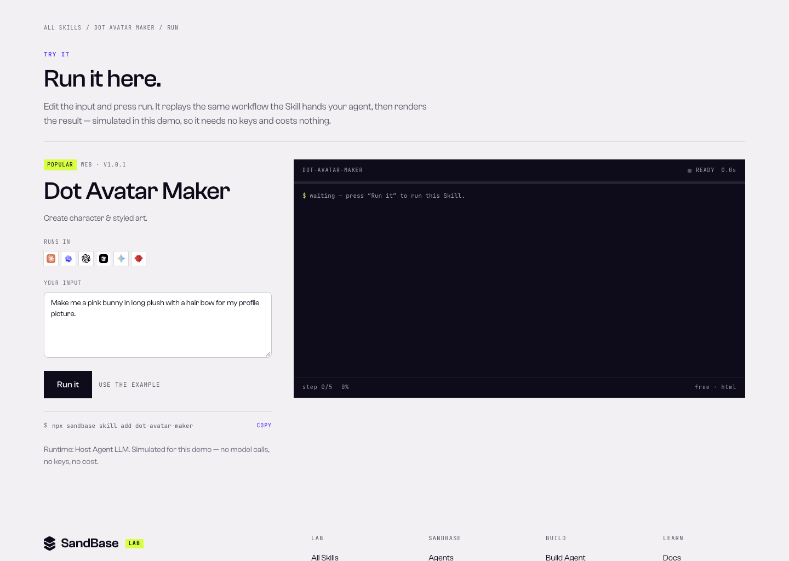
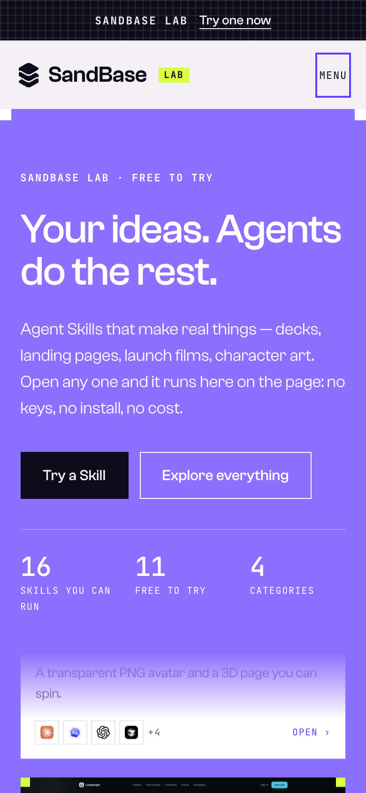
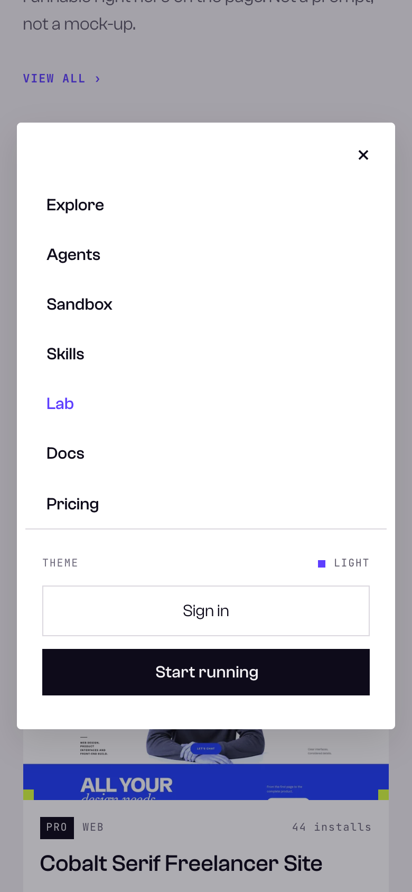
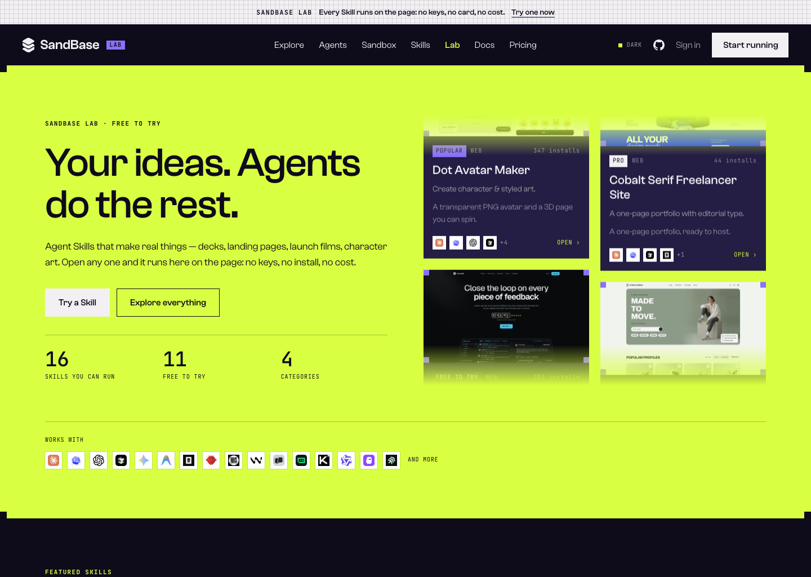

# SandBase Lab

**Your ideas. Agents do the rest.** A catalogue of Agent Skills that make real things — decks, landing pages, launch films, character art — and a workbench that runs any of them right on the page.

The copy and the vocabulary follow the live SandBase Lab at [sandbase.ai/lab](https://www.sandbase.ai/lab/): short declaratives, the meta row on every card (badge, category, count, then the result it hands back), the numbered "how it works" block, and a closing call for creators.

Standalone demo built on the [SandBase](https://www.sandbase.ai) design language: risograph-violet and lime spot inks on paper/ink stock, square corners, mono micro-labels, and no resting shadows.



---

## What it is

SandBase Lab is the landing page for a **new `Lab` entry in the SandBase navigation** (replacing the current `/lab`). Functionally it mirrors a Skill marketplace end to end:

- **Lab home** — hero, featured Skills, free Skills, trending by category (Web / Slides / Video / Image), how a Skill is made, connect-your-agent, pricing and FAQ.
- **Catalog** (`/lab/skills`) — search plus category and access filters over the whole library.
- **Skill detail** (`/lab/skills/[slug]`) — preview gallery, stats, what you get / good fit / not for, tags, per-Skill FAQ and similar Skills.
- **Run workbench** (`/lab/run/[slug]`) — the differentiator: run any Skill in the browser.
- **Pricing** (`/lab/pricing`) — one-plan pricing with a full FAQ.

The only functional difference from a plain Skills catalog: **every Skill can be run in the browser.**

<p align="center">
  
  
</p>

## Run in browser

Open any Skill and press **Run in browser**. The workbench replays the workflow the Skill hands your agent — reading `SKILL.md`, planning, generating, rendering — streaming a live transcript with a progress bar, step counter and elapsed time, then reveals the result and lets you download the transcript.

> **This run is simulated.** The demo has no backend and calls no model, so it works offline and for free. The transcript, timings and artwork are generated deterministically from the Skill's own definition, and the run respects `prefers-reduced-motion` (it completes instantly instead of streaming).



<p align="center">
  
  
  
</p>

## Highlights

- **Faithful to the SandBase design language** — the colour tokens, type ramp (`Clash Grotesk` + mono labels), square corners, `pixel-tile` grids and registration marks are lifted straight from the SandBase front end, so the Lab drops into the real site without a redesign.
- **Light & dark** — the full day/night token set with a theme control in the header; defaults to the paper look.
- **Hero Skill wall** — the home hero is a looping wall of full-size Skill cards: two lanes drifting at slightly different speeds behind a mask, so cards fade in and out rather than hard-cutting. Hovering or focusing a card stops the motion, and `prefers-reduced-motion` turns the lanes into plain manual scrollers.
- **Catalog that works** — search, multi-select category facets with counts, a free/premium filter and real sorting (featured, most installed, newest), with an empty state.
- **Real previews** — every card, gallery and run result shows the Skill's actual published result artwork (downloaded locally, no hotlinking), with a procedural SVG scene as a fallback if an image is missing. See [`docs/previews.md`](docs/previews.md).
- **Self-hosted fonts, no third-party requests** — Clash Grotesk and JetBrains Mono are loaded through `next/font`, so they are bundled and preloaded from this origin. No external stylesheet, no font CDN, no render-blocking request.
- **Accessible** — semantic landmarks, one `h1` per page with no skipped heading levels, a skip link, keyboard-friendly disclosures, one on-brand focus ring and reduced-motion fallbacks throughout.
- **Responsive** — verified from 390px to 1440px with no horizontal overflow; the mobile navigation opens as a fixed, dismissable sheet.
- **Static** — every route is prerendered, plus `robots.txt` and a generated `sitemap.xml`.

## Tech stack

`Next.js 14` (App Router) · `React 18` · `TypeScript` · `Tailwind CSS 3.4` · CSS Modules · `lucide-react` · ESLint. No database, no backend, no environment variables.

## Getting started

```bash
npm install
npm run dev      # http://localhost:4317
```

Other scripts:

```bash
npm run build      # production build
npm run start      # serve the production build
npm run lint       # eslint (next/core-web-vitals)
npm run typecheck  # tsc --noEmit
```

## Project structure

```
src/
  app/
    layout.tsx              # fonts (next/font), theme bootstrap, header + footer
    globals.css             # design tokens (colors, type, pixel grid)
    robots.ts sitemap.ts    # generated robots.txt and sitemap.xml
    lab/
      page.tsx              # Lab home
      skills/page.tsx       # catalog
      skills/[slug]/page.tsx# skill detail
      run/[slug]/page.tsx   # run workbench
      pricing/page.tsx      # pricing
  components/
    site-header.tsx         # SandBase nav incl. the new Lab entry
    ui/                     # design-system primitives (button, section, …)
    lab/                    # skill card, image, hero marquee, badges, FAQ, …
  features/lab/
    SkillCatalog.tsx        # search, filters and sorting
    RunConsole.tsx          # the run workbench
    run-simulator.ts        # deterministic streaming engine
  content/                  # skills, categories, agents, pricing, faq
  fonts/                    # Clash Grotesk webfont source
public/
  skills/<slug>/            # real result previews (card / main / alt-N)
  logos/agents/             # host-agent marks
```

## Design language

Ink `#0e0b1a` on paper `#f2f0f3`, with two spot inks — violet `#8b6fff` and lime `#d9ff43`. Headings set in **Clash Grotesk** at weight 500; everything data-ish (labels, ids, units, log lines) in **JetBrains Mono**, uppercase and tracked. Corners are square, cards are borderless tone changes, and motion is short, stepped and always paired with a reduced-motion fallback.

## Notes

This is an independent demo that reuses the SandBase visual language for illustrative purposes. Skill names, descriptions and preview artwork are the published results from [skillry.dev](https://skillry.dev); product names and logos of third-party agents (Claude Code, Codex, Cursor, Gemini, …) belong to their respective owners.

**Contrast.** Every text node was checked against WCAG AA in both themes. The night theme passes outright. In the day theme the only remaining misses are the deliberately-kept SandBase token pairing — `tint-blue` (violet) grounds with `tint-blue-fg` (white) text, used by the hero, the closing CTA and the pricing header — which lands at 3.6:1. Display type clears the large-text bar there; small labels on those grounds do not. Changing `tint-blue-fg` for those sections is a one-line fix if you want full AA.

## License

[MIT](LICENSE)
